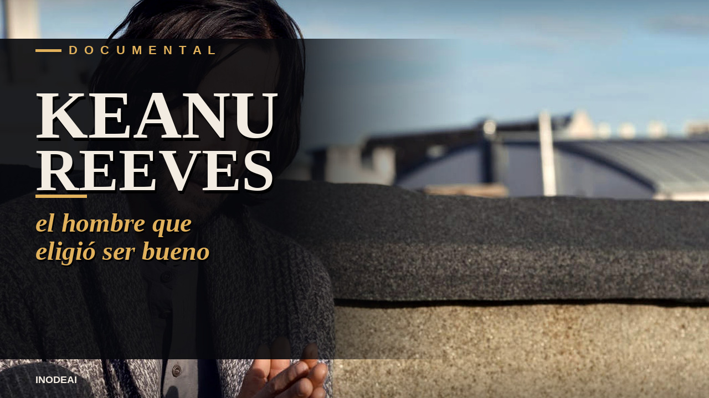
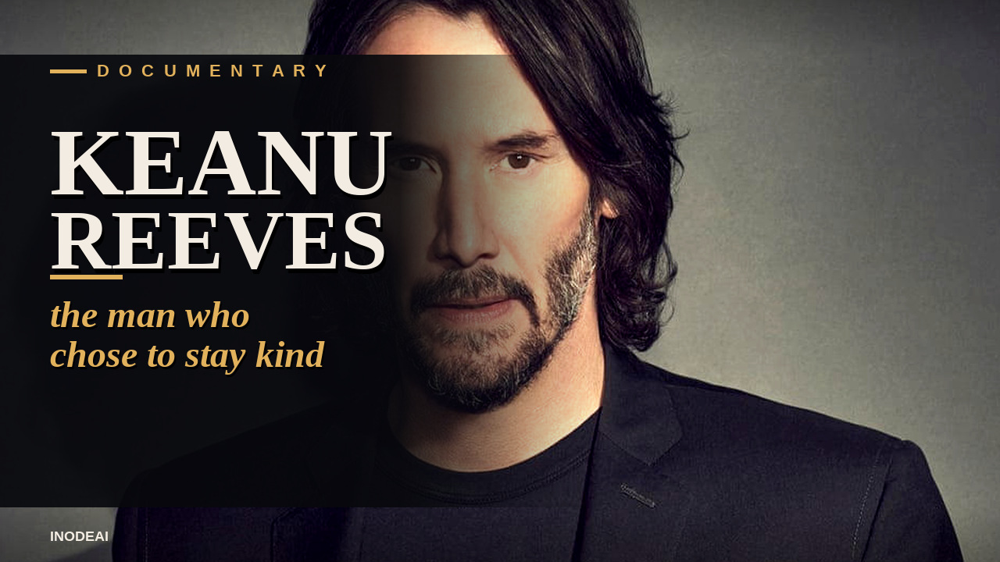

# Keanu Reeves — el lado humano

Documental listo para YouTube, en español y en inglés. Cada carpeta trae el video, la miniatura (cara del actor + título) y el texto para pegar: título, descripción y hashtags.

Canal: **InodeAi**

## Español

**Título:** Keanu Reeves: el hombre que eligió ser bueno

- Video: [youtube/espanol/keanu-es.mp4](youtube/espanol/keanu-es.mp4) (~9:36)
- Miniatura: [youtube/espanol/miniatura.jpg](youtube/espanol/miniatura.jpg) (1280×720)
- Texto para pegar: [youtube/espanol/TITULO-Y-DESCRIPCION.txt](youtube/espanol/TITULO-Y-DESCRIPCION.txt)

Hay una foto de un hombre comiendo un sándwich, solo, en un banco. Internet lo llamó el Keanu triste. Este documental no repite el mito. Cuenta por qué el mundo lo quiere de verdad.

Keanu Reeves perdió a su amigo River Phoenix. Perdió a su hija Ava, que nació muerta la Nochebuena de 1999. Perdió a Jennifer Syme. Y aun así eligió seguir siendo amable, en voz baja, sin cartel.

**Hashtags:** `#KeanuReeves` `#Documental` `#ElLadoHumano` `#JohnWick` `#Matrix` `#InodeAi` `#Cine` `#HistoriasReales` `#Bondad` `#Keanu`

## English

**Title:** Keanu Reeves: The Man Who Chose to Stay Kind

- Video: [youtube/ingles/keanu-en.mp4](youtube/ingles/keanu-en.mp4) (~8:46)
- Thumbnail: [youtube/ingles/thumbnail.jpg](youtube/ingles/thumbnail.jpg) (1280×720)
- Paste-ready text: [youtube/ingles/TITLE-AND-DESCRIPTION.txt](youtube/ingles/TITLE-AND-DESCRIPTION.txt)

There is a photograph of a man eating a sandwich, alone, on a bench. The internet called him Sad Keanu. This documentary does not repeat the myth. It tells why the world actually loves him.

Keanu Reeves lost his friend River Phoenix. He lost his daughter Ava, stillborn on Christmas Eve, 1999. He lost Jennifer Syme. And he still chose to stay kind, quietly, without a billboard.

**Hashtags:** `#KeanuReeves` `#Documentary` `#HumanStory` `#JohnWick` `#TheMatrix` `#InodeAi` `#Kindness` `#TrueStory` `#Cinema` `#Keanu`
